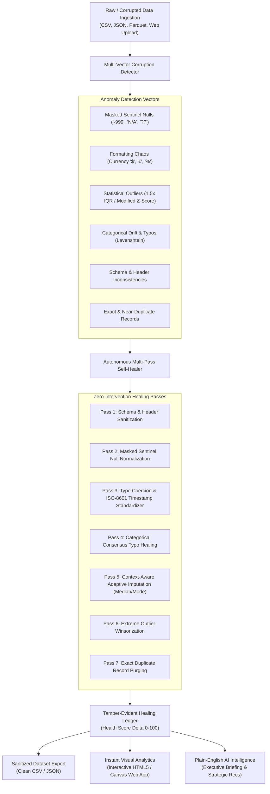

# AutoHeal AI: Autonomous Self-Healing Data Pipeline & Instant Analytics

[](https://deepakgoyal-dev.github.io/AutoHeal-AI/)
[](https://www.python.org/)
[](LICENSE)

**AutoHeal AI** is a zero-human-intervention autonomous data pipeline and interactive analytics web application. It ingests degraded, corrupted real-world data, autonomously detects anomalies across 6 vectors, executes 7 multi-pass self-healing repairs, calculates a Data Health Score ($0$ to $100$), and generates instant visual analytics with plain-English executive briefings.

👉 **Try the Live Web App in Your Browser:**  
**[https://deepakgoyal-dev.github.io/AutoHeal-AI/](https://deepakgoyal-dev.github.io/AutoHeal-AI/)**  
*(Drag and drop any raw CSV file to watch it self-heal and visualize instantly!)*

---

## 🌟 Key Architecture & Capabilities



---

## 🌐 Running on the Web

### Option A: 100% Client-Side Web App (GitHub Pages)
Visit the deployed application at **[https://deepakgoyal-dev.github.io/AutoHeal-AI/](https://deepakgoyal-dev.github.io/AutoHeal-AI/)**.
- **Zero Installation Required**: Runs directly in Chrome, Edge, Safari, or Firefox.
- **Drag-and-Drop Ingestion**: Drop any messy CSV into the browser window.
- **Client-Side Self-Healing**: Detects sentinels, parses currency strings, bounds outliers via IQR, and calculates before/after health deltas right in your browser.
- **Interactive Visualizations**: Canvas-based distribution histograms, correlation heatmaps, side-by-side diff inspectors, and searchable audit ledgers.

---

### Option B: Local Web Server with Python Backend
Run the high-performance local server:
```bash
python server.py --port 8000
```
Open **[http://localhost:8000](http://localhost:8000)** in your browser for local batch and REST API processing.

---

### Option C: Cloud Container Deployment (Docker / Render / Railway)
Build and run the Docker container:
```bash
docker build -t autoheal-ai .
docker run -p 8000:8000 autoheal-ai
```

---

## 💻 CLI & Autonomous Background Watcher

### 1. Run Autonomous Demonstration
```bash
python run_pipeline.py --demo all --rows 500
```

### 2. Process Custom File
```bash
python run_pipeline.py --input path/to/corrupted_data.csv
```

### 3. Continuous Background Watcher Mode
Watches `data/incoming/` continuously and self-heals files the moment they are dropped:
```bash
python run_pipeline.py --watch
```

### 4. Run Unit Test Suite
```bash
python -m unittest test_aegis.py
```

---

## 📊 Anomaly Resolution Matrix

| Anomaly Vector | Detection Heuristic | Autonomous Self-Healing Action |
| :--- | :--- | :--- |
| **Masked Sentinels** | Regex dictionary (`-999`, `N/A`, `??`, `null`, `missing`) | Normalizes to standard NaN, followed by context-aware imputation |
| **Dirty Types & Currency** | Currency regex symbols (`$`, `€`, `£`, `USD`) & percentage formatters | Regex numeric extraction, decimal parsing, and float casting |
| **Heterogeneous Dates** | Multi-pattern timestamp candidate evaluation | Normalizes mixed EU/US/ISO/Epoch strings to unified ISO-8601 |
| **Categorical Typos** | Low-frequency vs high-frequency Gestalt pattern matching | Maps typos to high-frequency ground truth (`>80%` similarity) |
| **Missing Values** | Skewness and cardinality profiling | Skewed: robust median; Symmetrical: Gaussian mean; Correlated: group median |
| **Statistical Outliers** | 1.5 * IQR & 3.0 * IQR bounds | Adaptive Winsorization (bounds extreme spikes to 1.5*IQR threshold) |
| **Duplicate Records** | Exact hash duplicate matching | Identifies redundant rows and purges duplicate entries |

---

## 📜 License
MIT License. Created by [Deepak Goyal](https://github.com/deepakgoyal-dev).
