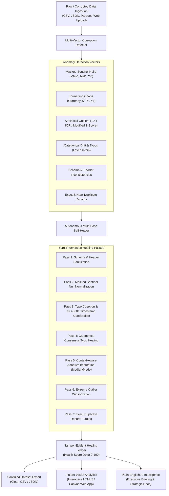

# AutoHeal AI: Autonomous Self-Healing Data Pipeline & Instant Analytics

[](https://deepakgoyal-dev.github.io/AutoHeal-AI/)
[](https://www.python.org/)
[](LICENSE)

**AutoHeal AI** is a zero-human-intervention autonomous data pipeline and interactive analytics web application. It ingests degraded, corrupted real-world data, autonomously detects anomalies across 6 vectors, executes 7 multi-pass self-healing repairs, calculates a Data Health Score ($0$ to $100$), and generates instant visual analytics with plain-English executive briefings.

---

## 👥 Project Team & Contributions

| Role | Name | GitHub Profile |
| :--- | :--- | :--- |
| **Team Lead** | **Deepak** | [@deepakgoyal-dev](https://github.com/deepakgoyal-dev) |
| **Team Member** | **Rudra** | Contributor |
| **Team Member** | **Nikhil** | Contributor |
| **Team Member** | **Riddhi Garg** | Contributor |

---

## 🌟 Key Architecture & Capabilities



---

## 🌐 How to Run on the Web

### Option 1: Live Public Web App (GitHub Pages)

The repository includes a ready-to-use client-side application in `index.html`. To make it accessible worldwide:

1. Open your repository on GitHub: **[https://github.com/deepakgoyal-dev/AutoHeal-AI](https://github.com/deepakgoyal-dev/AutoHeal-AI)**
2. Click **Settings** $\rightarrow$ **Pages** (on the left menu).
3. Under **Build and deployment $\rightarrow$ Branch**:
   - Select **`main`**
   - Select folder **`/(root)`**
   - Click **Save**.
4. Within 30 to 60 seconds, your site will be live at:
   👉 **[https://deepakgoyal-dev.github.io/AutoHeal-AI/](https://deepakgoyal-dev.github.io/AutoHeal-AI/)**

Visitors can drag and drop any CSV file into their browser to see it autonomously repaired with live charts, diff inspectors, and plain-English summaries.

---

### Option 2: Local Web Server

Run the Python server locally:
```bash
python server.py --port 8000
```
Open **[http://localhost:8000](http://localhost:8000)** in any browser.

---

### Option 3: Docker & Cloud Deployment

```bash
docker build -t autoheal-ai .
docker run -p 8000:8000 autoheal-ai
```

---

## 💻 CLI & Autonomous Watcher

```bash
# Run demonstration on enterprise datasets
python run_pipeline.py --demo all --rows 500

# Heal custom CSV/JSON file
python run_pipeline.py --input path/to/dirty_data.csv

# Run continuous folder watcher (heals files the instant they are dropped in)
python run_pipeline.py --watch

# Run unit tests
python -m unittest test_aegis.py
```

---

## 📊 Anomaly Resolution Matrix

| Anomaly Vector | Detection Heuristic | Autonomous Self-Healing Action |
| :--- | :--- | :--- |
| **Masked Sentinels** | Regex dictionary (`-999`, `N/A`, `??`, `null`, `missing`) | Normalizes to standard NaN, followed by context-aware imputation |
| **Dirty Types & Currency** | Currency regex symbols (`$`, `€`, `£`, `USD`) & percentage formatters | Regex numeric extraction, decimal parsing, and float casting |
| **Heterogeneous Dates** | Multi-pattern timestamp candidate evaluation | Normalizes mixed EU/US/ISO/Epoch strings to unified ISO-8601 |
| **Categorical Typos** | Low-frequency vs high-frequency Gestalt pattern matching | Maps typos to high-frequency ground truth (`>80%` similarity) |
| **Missing Values** | Skewness and cardinality profiling | Skewed: robust median; Symmetrical: Gaussian mean; Correlated: group median |
| **Statistical Outliers** | 1.5 * IQR & 3.0 * IQR bounds | Adaptive Winsorization (bounds extreme spikes to 1.5*IQR threshold) |
| **Duplicate Records** | Exact hash duplicate matching | Identifies redundant rows and purges duplicate entries |

---

## 📜 License
MIT License. Created by **Team Lead: Deepak** and **Members: Rudra, Nikhil, Riddhi Garg**.
