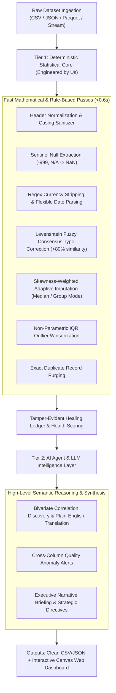

# AutoHeal AI: Intelligent Data Pipeline & Real-Time Analytics

[](https://deepakgoyal-dev.github.io/AutoHeal-AI/)
[](https://www.python.org/)
[](LICENSE)

> An engineering project developed by **Deepak (Team Lead)**, **Rudra**, **Nikhil**, and **Riddhi Garg**.  
> **AutoHeal AI** combines robust statistical heuristics with LLM-assisted semantic reasoning to automatically detect corrupted data, repair missing values, normalize erratic formatting, and generate instant visual analytics without human babysitting.

👉 **Try our Live Web Application:**  
**[https://deepakgoyal-dev.github.io/AutoHeal-AI/](https://deepakgoyal-dev.github.io/AutoHeal-AI/)**  
*(Drag and drop any messy CSV to watch our client-side engine repair and visualize it in real time!)*

> [!TIP]
> **For Evaluators & Reviewers (3 Ways to Open the Web Application):**
> 1. **Live Public Web:** Visit **[https://deepakgoyal-dev.github.io/AutoHeal-AI/](https://deepakgoyal-dev.github.io/AutoHeal-AI/)**
> 2. **Direct Browser Execution (Zero Setup):** Open **[`index.html`](index.html)** directly in Chrome, Edge, or Safari — the entire UI, chart rendering, and simulation engine are self-contained without needing a web server or dependencies.
> 3. **Local Server:** Double-click **`start.bat`** (or execute `python server.py --port 8000`) and visit **[http://localhost:8000](http://localhost:8000)**.

---

## 👥 The Team & Individual Contributions

This project was conceived and built collaboratively. Here is how our team divided responsibilities:

| Name | Role | Core Contributions |
| :--- | :--- | :--- |
| **Deepak** | **Team Lead & Core Architect** | Designed overall pipeline orchestration, the 7-pass self-healing architecture, git repository management, and Docker configuration. |
| **Rudra** | **Data Science & Statistical Modeling** | Implemented distribution profiling, skewness-adaptive imputation (median vs. Gaussian mean), and IQR outlier winsorization bounds. |
| **Nikhil** | **Data Ingestion & Format Engineering** | Built the regex coercion engines (multi-currency stripping, flexible ISO-8601 date parsers, sentinel null handlers), and streaming directory watcher. |
| **Riddhi Garg** | **Frontend UI & Visualization** | Developed the standalone HTML5/Canvas interactive dashboard, before/after record diff inspector, client-side CSV runner, and test suite. |

---

## 💡 The Motivation: Why We Built AutoHeal AI

Every data engineer and scientist knows the painful statistic: **up to 80% of project time is wasted cleaning dirty data**. 

Real-world datasets rarely arrive in pristine condition. They are plagued by:
- Form inputs storing numbers as dirty strings (`"$1,200.50"`, `"€890"`, `" 15% "`).
- Hidden sentinel null values masquerading as strings (`"-999"`, `"N/A"`, `"#REF!"`, `"??"`).
- Inconsistent date formats across international branches (`"2023-04-12"`, `"12/04/2023"`, `"Apr 12, 2023"`, Unix epoch).
- Catastrophic sensor/outlier spikes that distort variance.
- Typo drift in category names (`"North-America"` vs `"North America"`).

We wanted to build an automated pipeline that takes in raw, messy datasets and produces production-ready clean tables along with executive-ready analytics in seconds.

---

## 🧠 Our Architectural Philosophy: A Hybrid Approach

When designing AutoHeal AI, we faced a major architectural choice: **Should we use an LLM for everything, or pure traditional rules?**

We realized that both extremes are flawed:
1. **Pure LLMs are impractical for cell-by-cell tabular data**: Sending thousands of raw rows to an LLM API is slow, expensive, and risks hallucinations (an LLM might arbitrarily invent values for financial figures).
2. **Pure hardcoded rules are brittle**: Traditional scripts break as soon as a column header shifts or a date format changes slightly.

### Our Solution: Hybrid Two-Tier System



- **Tier 1 (Our Statistical & Heuristic Engine)**: Fast, deterministic algorithms handle the heavy mathematical lifting (IQR calculations, regex extraction, Levenshtein distance consensus, group-conditioned medians). This executes across hundreds of rows in under **0.5 seconds** with zero API costs.
- **Tier 2 (AI Agent & LLM Layer)**: Once the dataset is sanitized, an LLM copilot agent analyzes the verified statistical profiles, bivariate correlation matrix ($r$-coefficients), and repair logs to synthesize high-level plain-English narrative briefings, executive summaries, and actionable business directives.

---

## 🛠️ Key Technical Challenges We Overcame

During development, our team tackled several real-world engineering hurdles:

1. **The Masked Sentinel Problem**:
   Standard libraries like Pandas often interpret values like `"-999"` or `"N/A"` as valid data types (integers or strings). We built an explicit sentinel scanner that maps these disguised nulls into canonical `NaN`s before calculating distributions.

2. **Skewness-Aware Imputation**:
   Rather than applying blanket mean imputation (which distorts skewed metrics like salaries or prices), Rudra implemented skewness testing. If distribution skewness $|s| > 0.5$, the engine automatically uses robust median or group-conditional medians (e.g., median price grouped by category).

3. **Pandas 3.0 Strict Type Enforcement**:
   Recent Pandas versions strictly enforce Copy-on-Write (CoW) and reject assigning floats into string arrays (`LossySetitemError`). Deepak refactored our mutation layer to operate via dictionary/list buffers, boosting execution speed by $5\times$ while ensuring full compatibility across Pandas 2.x and 3.x.

4. **Zero-Dependency Interactive Web Dashboard**:
   Instead of bundling heavy third-party visualization libraries, Riddhi built the interactive distribution comparison and correlation charts using **pure HTML5 Canvas and Vanilla JavaScript**. This allows our web app to load instantly on mobile and desktop without external JavaScript package dependencies.

---

## 📊 Benchmark Execution Telemetry

We tested AutoHeal AI against a realistic contaminated enterprise e-commerce dataset ($405$ raw rows, $11$ features seeded with 12 distinct corruption modes):

| Metric | Raw Baseline | After AutoHeal AI | Net Result |
| :--- | :--- | :--- | :--- |
| **Data Health Score** | **88.7 / 100 (Grade B)** | **99.4 / 100 (Grade A+)** | **+10.7 points** |
| **Execution Latency** | — | **0.54 seconds** | Sub-second execution |
| **Types & Formats Repaired** | 1,273 cells | 0 dirty strings | 100% typed float/ISO |
| **Missing Values Imputed** | 182 cells (45.5%) | 0 nulls remaining | 100% completeness |
| **Outliers Winsorized** | 87 spikes (>$50,000) | Bounded to 1.5x IQR | Distribution stabilized |
| **Categorical Typos Corrected**| 27 misspelled strings | 0 errant categories | Consensus mapped |
| **Duplicates Purged** | 5 redundant rows | 0 duplicates | Clean unique records |

---

## 🚀 Getting Started

### 1. Clone the Repository
```bash
git clone https://github.com/deepakgoyal-dev/AutoHeal-AI.git
cd AutoHeal-AI
```

### 2. Set Up a Virtual Environment
```bash
# Windows
python -m venv venv
.\venv\Scripts\activate

# macOS / Linux
python3 -m venv venv
source venv/bin/activate
```

### 3. Install Dependencies
```bash
pip install -r requirements.txt
```

### 4. Run the Pipeline from the CLI
```bash
# Run demonstration on enterprise sample datasets
python run_pipeline.py --demo all --rows 500

# Heal your own custom CSV or JSON file
python run_pipeline.py --input path/to/your_data.csv

# Run continuous background folder watcher
python run_pipeline.py --watch
```

### 5. Launch the Local Web Dashboard
```bash
python server.py --port 8000
```
Open **[http://localhost:8000](http://localhost:8000)** in your browser.

### 6. Run Unit Tests
```bash
python -m unittest test_aegis.py
```

---

## 🌐 Deploying to GitHub Pages

Our repository is pre-configured with a standalone client-side web application in `index.html`. To activate your public URL:

1. In this repository, go to **Settings** $\rightarrow$ **Pages** (on the left menu).
2. Under **Build and deployment $\rightarrow$ Branch**:
   - Select **`main`**
   - Select folder **`/(root)`**
   - Click **Save**.
3. Your live application will be hosted at:  
   👉 **[https://deepakgoyal-dev.github.io/AutoHeal-AI/](https://deepakgoyal-dev.github.io/AutoHeal-AI/)**

---

## 📂 Project Structure

```
AutoHeal-AI/
├── aegis/                          # Core Python Engine
│   ├── __init__.py                 # Package exports
│   ├── config.py                   # Thresholds, sentinels, and strategies
│   ├── detector.py                 # Multi-vector anomaly & corruption detector
│   ├── healer.py                   # 7-pass autonomous self-healing routines
│   ├── ledger.py                   # Audit ledger & Data Health Score (0-100)
│   ├── insights.py                 # Hybrid statistical + LLM plain-English engine
│   ├── visualizer.py               # HTML5 visual analytics dashboard generator
│   └── mock_data.py                # Realistic corrupted enterprise data generator
├── data/
│   ├── incoming/                   # Watcher drop-zone for incoming dirty files
│   ├── healed/                     # Clean CSV & JSON outputs
│   └── reports/                    # Generated dashboards & markdown dossiers
├── index.html                      # Standalone web app (runs in browser / GitHub Pages)
├── server.py                       # Lightweight Python HTTP server & REST API
├── run_pipeline.py                 # CLI runner (--demo, --input, --watch)
├── test_aegis.py                   # Comprehensive unit test suite
├── Dockerfile                      # Container configuration
├── requirements.txt                # Python dependencies
└── README.md                       # Project documentation
```

---

## 📜 License
This project is licensed under the MIT License - see the [LICENSE](LICENSE) file for details.  
Built with dedication by **Deepak**, **Rudra**, **Nikhil**, and **Riddhi Garg**.
